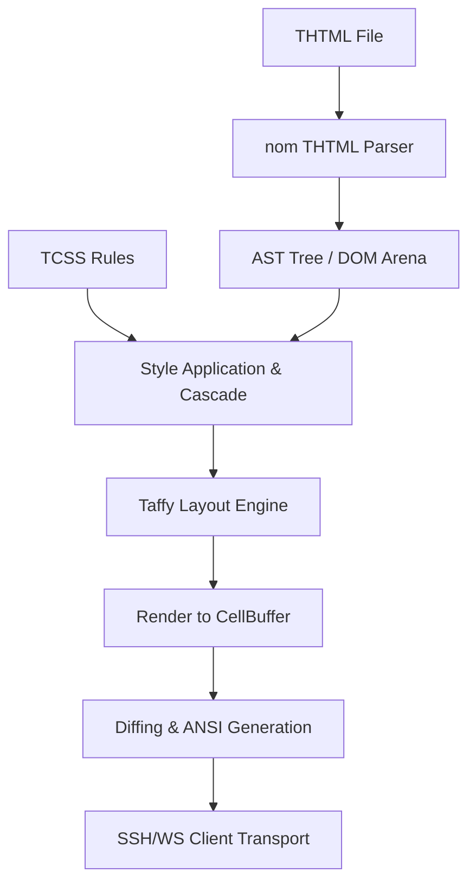

# OxiTerm Architecture

This document details the architecture of the OxiTerm system — a TUI (Terminal User Interface) framework operating in a Server-Side Rendering (SSR) model.

---

## 1. THTML (Terminal HTML)

The THTML markup language is used to declaratively describe the structure of the terminal interface.
* **`<screen>`**: The implicit top-level container (root) of the document, representing the entire terminal workspace.
* **`<box>`**: A universal layout container (equivalent to `
`). Supports full Flexbox positioning.
* **`<text>`**: Represents text content. Supports word-wrapping (`wrap: word`, resolved via Taffy measure functions so height follows the wrapped width), Unicode characters, double-width characters (e.g. CJK), and emojis.
* **`<input>`**: An interactive text field for keyboard character input.
* **`<button>`**: A focusable button that triggers action events.
* **``**: Embeds SVG vector graphics (`.svg`), Lottie animations (`.json`), and interactive Rive controls (`.riv`). Vector graphics are rasterized in real-time to pixels using `resvg` and `tiny-skia` libraries, and then transmitted using the terminal's graphics protocol.
* **`<video>`**: Enables smooth video playback (`.mp4` and others). Video frames are decoded and rasterized in the background using the `ffmpeg` tool.
* **`<for>`**: A loop template. Its single child is cloned once per element of a `List` state value named by the `each` attribute; `{item}` in the template's text is substituted per iteration, and the block re-expands reactively on state change.
* **`<diagram>`**: Renders Mermaid flowchart diagrams as character cell grids with `minimap`, `crop`, and `fit` preview modes.

---

## 2. TCSS (Terminal CSS)

TCSS is a simplified CSS dialect tailored for character grids.
* **Units:** Dimensions (width, height, margin, padding) are expressed as integers representing character cells.
* **Layout:** Supports Flexbox (directions, alignment, gaps).
* **Colors:** Supports TrueColor (24-bit RGB), 256-color ANSI palette, named colors, and special values (`reset`, `transparent`).
* **Borders:** Generated using Unicode semigraphics (Box Drawing Characters) in the following styles: `single`, `double`, and `rounded`.

---

## 3. SSR Rendering Pipeline (Server-Side Rendering)

The process of generating the frame and sending it to the client proceeds in the following steps:

1. **THTML Parsing:** The parser, based on the `nom` library, builds a DOM tree inside an optimized memory arena (`DOM Arena`), filtering and sanitizing dangerous tags and attributes.
2. **Style Cascade:** TCSS rules from the `<style>` block and inline `style` attributes are applied to nodes in a single cascade pass, resolving priorities (tag < class < id < inline).
3. **Layout Calculation (Layout Engine):** The **Taffy** engine calculates the final positions and sizes of each element on the terminal grid. At this stage, `bind-show` conditions are evaluated — invisible nodes are marked as `Display::None` and consume no space.
4. **Rendering to Buffer:** The built tree with calculated dimensions is drawn to a two-dimensional frame buffer (`CellBuffer`). Multimedia elements (SVG/Lottie/Rive/Video) are rasterized to pixels and compressed to Kitty/Sixel formats.
5. **ANSI Generation (Diffing Engine):** The final frame in the buffer (`DoubleBuffer`) is compared with the previous frame sent to the client. A minimal sequence of ANSI escape codes is generated to control the cursor and colors, dramatically reducing network overhead.

---

## 4. Transport Architecture

OxiTerm supports two independent TUI image distribution channels:
* **SSH Server (russh):** An asynchronous SSH daemon. It negotiates PTY parameters (window dimensions, Kitty Graphics, SGR mouse) and captures input byte streams from the client, returning compressed ANSI diffs.
* **WebSocket Server:** Enables running OxiTerm applications directly in web browsers. The frontend is a custom Rust→WASM client (`oxiterm-web`, class `WebTerminal`) that decodes the server's binary cell-diff stream and paints it onto an HTML `<canvas>` — it does **not** use xterm.js. Media (SVG/Lottie/Rive/video) is overlaid as positioned DOM elements above the canvas.

---

## 5. Resilience and Optimizations

OxiTerm's performance and stability in a network environment rely on several key mechanisms:
* **Resilient Reactor Thread (RRT):** A dedicated, non-blocking OS thread used to read user input from SSH. The RRT parses the raw byte stream into keyboard and mouse events (Kitty/SGR) using the `InputStateMachine`, preventing the event loop from blocking and mitigating DoS attacks (e.g., excessively long escape sequences are rejected in `sanitize_frame`).
* **Dynamic Ticking Loop:** In an idle state, the rendering loop sleeps for `5ms` awaiting events. If there are active Lottie or Rive animations in the DOM tree, OxiTerm dynamically raises the refresh rate to 15 FPS (`66ms` tick) for smooth animation playback.
* **Dual-Tier Graphic Cache:**
  - `SvgCache`: Stores once-parsed `usvg::Tree` vector structures to avoid repeating expensive XML parsing.
  - `AssetCache`: Stores pre-compressed Sixel/Kitty graphic byte streams matching the current frame resolution, bypassing the entire rasterization process when there are no changes.
* **Synchronized Updates (BSU/ESU):** Prevents screen tearing by wrapping ANSI diff packets in the terminal frame synchronization protocol (`\x1b[?2026h` / `\x1b[?2026l`).
* **Predictive Local Echo:** A local text prediction buffer that minimizes network latency for users typing in `<input>` fields.
* **Backpressure (Congestion Control):** A bounded frame channel (`BoundedFrameChannel`). Slow client terminals that cannot keep up with receiving diffs cause safe frame dropping on the server, preventing memory leaks.
* **Scrollback Buffer Clearing:** Upon startup and resize, a `\x1b[3J` sequence is sent to clear the client's scrollback history, preventing graphic artifacts.

---

## 6. Accessibility

When launching the server with the `--a11y` flag, the engine switches to the **LinearFrameSink** mode:
* Instead of a two-dimensional ANSI buffer, the document is rendered as a linear text tree, ideal for screen readers.
* The `oxiterm-a11y` crate exposes an AT-SPI/D-Bus API surface (`DBusBridge`, `register_at_spi`, `update_focus`), but **the transport layer is not yet implemented** — no D-Bus connections are established at runtime. The API is a skeleton for future integration with speech synthesizers and Braille displays.

**GUI web clients (`?gui=1`, display-list sessions) get an ARIA mirror.** The canvas is opaque to screen readers, so the server also sends the accessibility tree as JSON (`0x37`, see §7b) and the client renders it as transparent, non-`display:none` DOM positioned over the canvas (buttons as `<button>`, inputs as `role="textbox"`, images as `role="img"`, labelled groups as `role="group"`, the root as a labelled region). Keyboard focus stays on the canvas, which carries `role="application"`, `aria-owns` and `aria-activedescendant` pointing at the mirrored focused element; an `aria-live="polite"` region announces focus changes. A click dispatched on a mirrored button by assistive technology is translated into a mouse press + release at the centre of that node. The text of `<input type="password">` is never sent.

---

## 7. Mobile Responsive Support

OxiTerm features a unified, client-driven responsive design system:
* **Single Client Interface:** The web server serves a unified responsive `index.html` at `/` for all devices. Path-based redirections, multiple HTML documents (`index_mobile.html`), and cookies have been fully removed.
* **Client-Side Classification:** The browser client determines its device classification based on viewport size. Screen widths under `800px` are classified as mobile.
* **Viewport Sync Protocol:** 
  - **Initial Sync:** On WebSocket connection, the client sends a `0x11` binary viewport configuration message containing the initial mobile status flag (`1` for mobile, `0` for desktop).
  - **Dynamic Resize:** If the physical window is resized across the `800px` threshold, the client sends an updated `0x11` message.
* **Server-Side Hot Swap:** When the server receives a `0x11` message, it stores the mobile status in `ClientSession::is_mobile` and issues a `SwitchViewport(is_mobile)` event to the event loop. The event loop reloads the current page layout in real time.
* **Dynamic Template Resolution:** During page loading, the resolver checks if a mobile variant (suffixed with `_mobile.thtml`) exists on disk. If found and `is_mobile` is true, the mobile variant is served; otherwise, it gracefully falls back to the default desktop layout.
* **Mobile-Optimized Layouts:** Mobile templates target a standard PTY grid of `48x30` cells, featuring stacked visual hierarchies and larger interaction tap targets.

---

## 7b. Display-List Protocol (OxiUI phase 3a/3b)

Web clients may opt in to receive a `DisplayList` per frame instead of cell diffs (see [oxi-ui.md](oxi-ui.md)). Since phase 3b the session's layout engine runs in `RenderMode::Gui` for such clients (fractional rects, origins and sizes; it switches back to Tui when the flag is reset), and the builder keeps that geometry instead of snapping it. The client paints with vector primitives. Wire version is now 2. Clients that do not opt in, and SSH, are unaffected.

**Negotiation (client to server):** `0x12 <caps:u8>`. Bit 0 = "display list". The server stores `ClientSession::display_list_client`, emits `InputEvent::SetDisplayList(on)`, and the event loop reparses the current page with `RenderMode::Gui` (`@media gui` rules apply) and re-renders. All later page loads use the same mode. The capability is **per connection**: it is reset to cell diffs on every new connection, reattach or takeover (re-parsing the page in TUI mode if it was set), and the client must resend `0x12` each time. A `0x12` from a superseded connection is ignored. Clients should send `0x12` **before** their first `0x10`: the handshake then already knows the mode, so the page is parsed in GUI mode from the start and the first frame is a display list (no cell frame first). A `0x12` sent after the first `0x10` still works, but the client briefly sees a cell frame before the switch.

**Frames (server to client):** `0x36` followed by a **zlib** stream (RFC 1950, i.e. browser `DecompressionStream('deflate')`) of `wire::encode(list)`. (`0x30` was already taken by the page announce, so the display list uses `0x36`.) A frame is sent only when the encoded list differs from the last one sent; after a (re)attach the next frame is always sent. No cell-diff frames (`0x01..`) are sent to such a session. `0x20`/`0x21` media messages, `0x30` page announce, `0x32`..`0x35` notices and `0xFF` are unchanged.

**ARIA mirror (`0x37`, phase 3c):** server to client, `0x37` followed by UTF-8 JSON, sent only to display-list sessions, right after the display list of the same frame and only when the bytes differ from the last one sent (reset on epoch change/reattach like the list):
`{"v":1,"focus":<node id|null>,"nodes":[{"id":u32,"role":"button|textbox|img|group|text|application","label":"…","value":"…"|null,"x":f32,"y":f32,"w":f32,"h":f32,"children":[…]}]}`.
Geometry is in the same logical cell units and absolute coordinates as the display list (centering and scroll applied; `position: fixed` nodes use the unscrolled origin). Nodes without a layout rect (hidden by `bind-show`/`display: none`) are dropped with their subtrees, unlabeled empty containers are pruned, a button's text children are folded into its label, and `value` is always `null` for `<input type="password">`. Built by `oxiterm_a11y::build_aria_json`; sent via `FrameSink::send_a11y`.

**Inflated payload** (`oxiterm-renderer/src/render/wire.rs`, all little-endian):

| Element | Layout |
|---|---|
| list | `version:u8 (=2)`; the decoder accepts only 2, `count:u32`, then `count` items; no trailing bytes |
| colour | `0` (Reset) \| `1 r g b` (TrueColor) \| `2 idx` (Color256) |
| rect | `x:f32 y:f32 w:f32 h:f32` |
| f32 | little-endian IEEE-754; NaN and infinities are rejected by the decoder |
| char | `u32` Unicode code point |
| mods | `u8`: `1` bold, `2` underline, `4` italic, `8` skip (grid cells only; wide-glyph trailer, do not draw) |
| `1` Fill | `node:u32 rect radius:f32 fg bg` : cells in `rect` become `' '` with `fg`/`bg` |
| `2` Border | `node:u32 rect radius:f32` + 8 chars (`top_left top top_right left right bot_left bot bot_right`) + `fg bg` |
| `3` Text | `node:u32 origin_x:f32 origin_y:f32 clip:rect fg bg mods:u8 n:u32` + `n` x (`x:f32 y:f32 ch:char advance:f32`); glyph positions are relative to `origin` |
| `4` Legacy | `node:u32 rect` (never sent by the server; replaced by CellGrid) |
| `5` PushClip | `rect` |
| `6` PopClip | (empty) |
| `7` CellGrid | `rect n:u32` + `n` x (`ch:char fg bg mods:u8`), row-major, `n = w*h`; paint verbatim |
| `8` Path | `node:u32 n:u32` + `n` commands + `fill_flag:u8` (`0` none, `1` + colour) + `stroke_flag:u8` (`0` none, `1` + colour + `width:f32`) |
| path command | `op:u8` + f32 operands: `0` MoveTo `x y`; `1` LineTo `x y`; `2` QuadTo `cx cy x y`; `3` CubicTo `c1x c1y c2x c2y x y`; `4` Close (no operands). Any other op is an error. Flags other than 0/1 are errors. |

**Units (v2).** Everything is in logical cell units. `Fill`/`Border` `radius` (0 = square) and the Path stroke `width` are measured along the horizontal axis: a GUI painter multiplies them by the cell width in pixels. Path x/y coordinates are absolute and scale by cell width and cell height respectively. `rect`s and text `origin`/`clip` may be fractional; glyph `x`/`y` offsets inside a text run remain whole cells (text wraps against `floor(inner width)` columns). The cell sink (and so the TUI) ignores `radius` and `Path` completely; they are GUI-only. `radius` comes from the TCSS `border-radius` property.

**Input.** Mouse input is still cell-based (`0x02 col,row`, hit-tested at the cell centre). Sub-cell pointer precision is a later step.

Items are painted in list order, later items overwrite earlier ones. The first item is a full-viewport `Fill` (the page background), so a client may repaint from scratch each frame. `img`/`video`/`diagram` areas and session overlays (focus ring, predictive echo, scroll indicator) arrive as `CellGrid` items. Painting the list onto an empty cell buffer reproduces the cell frame exactly.

---

## 8. Session Lifecycle & Reconnection

OxiTerm manages connections separately from persistent interactive sessions:
* **Session Reattachment:** Browser clients can reattach to existing server-side sessions by presenting a unique session token via the WebSocket connection query string.
* **Connection Takeover:** If a user opens the session in a new tab or window, the server registers the new connection and issues a `0xFF` control byte to the old connection. The old connection immediately terminates its socket and stops auto-reconnection attempts, avoiding contention between the two clients.
* **Session Token Hygiene:** When a session is established or reattached, the client extracts the `session` token from the URL, writes it to `sessionStorage`, and strips it from the address bar history. The visible URL displays only the page query parameter (`?page=`).
* **Auto-Reconnection:** On accidental disconnection, the client enters an auto-reconnection loop with exponential backoff capped at 8 seconds.
* **Reattach Navigation:** If the reattachment URL specifies a different page (e.g., `?page=other.thtml`), the server validates the path and triggers a navigation event (`NavigateTo`) to synchronize the session state to the new page.

---

## 9. Retro Hardware & Desktop Environment ("OxiDE")

For a detailed blueprint on adapting OxiTerm as a standalone Desktop Environment (GUI/DE) for vintage and resource-constrained Linux hardware (direct `/dev/fb0`, DRM/KMS, raw TTY console, multi-window compositing, and D-Bus system integration), see [docs/retro-desktop-environment.md](retro-desktop-environment.md).

